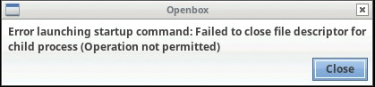
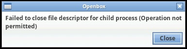

# Old Docker hosts: "Failed to close file descriptor for child process"

If Openbox shows these errors when the desktop starts or when you start a program:




update Docker (and libseccomp) on the host. If you can't, run the container without Docker's seccomp profile:
```
--security-opt seccomp=unconfined
```
```
docker run -d -p 127.0.0.1:5901:5901 --security-opt seccomp=unconfined ghcr.io/fullaxx/ubuntu-desktop
```
- **Why:** GLib, which Openbox uses to start programs, calls `close_range` for the new program's file descriptors. Docker and libseccomp versions from 2021 and earlier didn't know that system call, so Docker's seccomp profile refused it ("Operation not permitted"), and the GLib of that time took that as an error. Newer GLib falls back instead.
- **Seen with:** Ubuntu 22.04 images, in 2022. Current Docker doesn't have this problem.
- **The cost:** `seccomp=unconfined` turns off Docker's filter on system calls for this container.
- **Ubuntu 26.04 images** keep loading GTK images with this option, thanks to the image's bubblewrap workaround ([PRIVILEGES.md](../PRIVILEGES.md#gtk-images-and-bubblewrap)).
